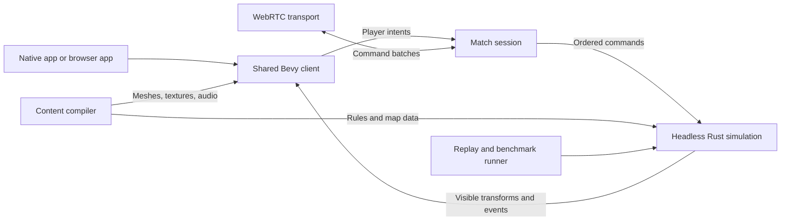

# Architecture

## One game on two platforms

Use a Rust workspace with a headless simulation and a shared Bevy client. Compile the desktop edition into an OS-native executable. Compile the web edition to WebAssembly and serve it with a thin web page and versioned assets over HTTPS. Keep camera, selection, commands, HUD, and gameplay behavior shared. The platform entry points handle startup, file or browser storage, transport, and app lifecycle.

WebGPU is the first browser rendering target. Test actual adapter and device creation before loading match assets and display a clear compatibility message on failure. Treat WebGL2 as a candidate for wider coverage and run the same benchmark before committing to it. It may require a reduced graphics profile. Bevy provides examples for both browser backends. [Bevy WebGPU examples](https://bevy.org/examples-webgpu/) · [Bevy WebGL2 examples](https://bevy.org/examples/) · [wgpu web platform documentation](https://wgpu.rs/doc/wgpu/documentation/platforms/web/index.html)

| Candidate | Fit for Terminal Command |
| --- | --- |
| **Rust and Bevy** | Start here. It keeps the gameplay core in the same language on both platforms and supplies rendering, input, audio, and UI foundations. Prototype packed unit rendering early, since the default approach to scenes and entities still needs to be tested at this scale. [Bevy quick start](https://bevy.org/learn/quick-start/getting-started/setup/) |
| Rust and direct wgpu | Keep as a fallback if Bevy's presentation overhead or platform integration blocks the target after profiling. The headless simulation can carry over. Direct wgpu increases the amount of rendering, tooling, and UI work. [wgpu documentation](https://wgpu.rs/doc/wgpu/) |
| Godot and a custom simulation | A viable option if editor productivity becomes the priority. The documented Godot 4 web export uses the Compatibility renderer on WebGL2, so it would need a fresh browser performance and native/Wasm extension test. [Godot web export](https://docs.godotengine.org/en/stable/tutorials/export/exporting_for_web.html) |
| Recoil | A strong RTS reference for large battles, deterministic ticks, and data-driven gameplay. Its public release path leaves browser deployment unproven for this project, so treat it as a reference while testing the shared Rust build. [Recoil Engine](https://recoilengine.org/) · [Recoil performance notes](https://github.com/beyond-all-reason/RecoilEngine/blob/master/coding-agents/ENGINE_PERFORMANCE.md) |

## Module boundaries

The diagram shows data flow. The simulation owns the match state. The session owns command ordering, tick pacing, replay recording, and connection state. Presentation reads a player-specific view and sends intents. Changing visual settings cannot change a match outcome.

| Proposed location | Owns |
| --- | --- |
| `crates/sim` | Match rules, unit state, economy, movement, combat, visibility, and canonical state hashing. Builds without a window, GPU, or network. |
| `crates/session` | Local, replay, or multiplayer input, match compatibility, turn buffering, and versioned command messages. |
| `crates/client` | Bevy rendering, audio, camera, input mapping, selection, and UI. |
| `apps/desktop`, `apps/web` | Platform entry points, WebRTC adapters, packaging, and the browser page. |
| `content`, `tools` | Authored definitions and assets, content compilation, and repeatable replay and performance workloads. |

## Browser execution and rendering

Run the browser simulation in a dedicated Worker, with Bevy rendering and browser WebRTC setup on the page thread. Give the native simulation the same message boundary so it can run on a dedicated thread. Exchange tick-tagged, packed view updates with reusable buffers. Test the cost of filling transferable buffers from Wasm memory as part of the first prototype. Require cross-origin isolation only if measured gains justify adding shared memory later. [WHATWG Web Workers](https://html.spec.whatwg.org/multipage/workers.html) · [HTML cross-origin isolation](https://html.spec.whatwg.org/multipage/webappapis.html#dom-crossoriginisolated)

Begin with bounded delivery of complete views of visible units. The client can skip stale views and interpolate between the most recent complete pair. If profiling calls for deltas, tag each delta with its base tick and recover from a gap with a complete view. Use lossless queues for command batches and command results. Chunk the terrain, cull by camera, and batch unit meshes and tactical icons by mesh and material. Scale shadows, particles, animation detail, and render resolution by graphics profile. Profile view transfer, CPU submission, and GPU time separately before changing the simulation.

Serve the web build and assets with content-addressed URLs and load the selected map and roster before entering a match. Install the corresponding core content with the native build. Use the same match rules and compatibility checks on both platforms. The match sets the shared unit cap. Device capabilities affect the graphics profile.
